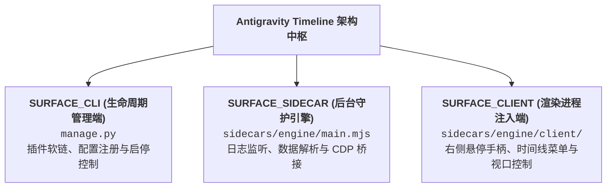
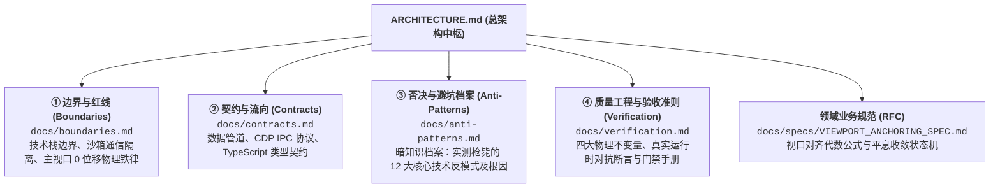

# 系统总架构指南 (System Master Architecture)

本项目为 Antigravity 桌面客户端提供非侵入式的对话时间线导航与智能视口控制能力。
依托 Antigravity 原生 Sidecar 运行机制与 Chrome DevTools Protocol (CDP) 调试信道，实现右侧手柄悬停展开全量对话提问列表、冷数据按需挂载平滑定位、智能视口防滚屏锁定与热重载。

---

## 1. 意图-文档路由索引表 (Documentation Sitemap)

> [!IMPORTANT]
> **新会话启动防失忆协议**：新会话开启时，智能体根据用户改动意图，对照下表定位责任表面与对应业务契约，严禁脱离文档盲目推测修改。

| 变动诉求 / 业务意图 | 责任物理目录 / 表面 | 唯一受信任业务契约 (Spec) | 严禁触碰的物理红线 (Invariants) |
| :--- | :--- | :--- | :--- |
| **视口跳转算法、平滑对齐或到达守护** | `sidecars/engine/client/panel.js` | [`docs/specs/VIEWPORT_ANCHORING_SPEC.md`](docs/specs/VIEWPORT_ANCHORING_SPEC.md) | 悬停主视口位移严格恒等于 0px；严禁调用模拟点击展开历史消息 |
| **会话日志监听、推送管道与 CDP 信道** | `sidecars/engine/main.mjs` | [`docs/contracts.md`](docs/contracts.md) | 单向数据流管道；严禁跨越沙箱直接操作前端 DOM 树 |
| **插件安装部署、符号链接与生命周期** | `manage.py` | [`docs/boundaries.md`](docs/boundaries.md) | 严禁篡改宿主底层应用包与 `app.asar` 归档 |
| **质量工程、自动化断言与时序稳态测试** | `sidecars/engine/test_e2e.mjs` | [`docs/verification.md`](docs/verification.md) | 严禁脱离 Electron 真实调试树的伪 Mock 测试 |

---

## 2. 表面隔离与拓扑矩阵 (Multi-Surface Isolation Matrix)

| 表面标识 | 物理目录 | 运行环境与权限沙箱 | 架构设计特性 | 单入口门禁 |
| :--- | :--- | :--- | :--- | :--- |
| **SURFACE_CLI** | `manage.py` | Python 3 (标准库) | 独立管理工具，零外部依赖设计 | `manage.py status` |
| **SURFACE_SIDECAR** | `sidecars/engine/` | Node.js 原生 ES Module | 宿主底层守护进程，零第三方依赖，内存增量直出 | `manage.py test` (阶段 1-3) |
| **SURFACE_CLIENT** | `sidecars/engine/client/` | Chromium 渲染上下文 | 动态注入 IIFE，遵循浏览器安全沙箱 | `manage.py test` (阶段 4-6) |

---

## 3. 四维工程真理库索引 (The 4 Pillars of Architecture)

系统架构知识按四维真理库进行解耦分治，按需检索与渐进式加载：

### 1. [① 边界与红线 (docs/boundaries.md)](docs/boundaries.md)
* **适用场景**：涉及模块重构、权限边界划分、技术栈约束或跨环境调用时必读；
* **核心内容**：主视口 0 像素位移铁律、Chromium 沙箱禁止本地文件跨域读取、后台守护宿主托管原则。

### 2. [② 契约与流向 (docs/contracts.md)](docs/contracts.md)
* **适用场景**：涉及接口变更、数据流向改造、新增通信字段或卡片排版更新时必读；
* **核心内容**：底层 `transcript.jsonl` 单一真实源管道、CDP 双向绑定方法、TypeScript 接口契约。

### 3. [③ 否决与避坑档案 (docs/anti-patterns.md)](docs/anti-patterns.md)
* **适用场景**：排查定位异常、尝试新优化算法或考虑重构方案时必读；
* **核心内容**：详细记录为什么不能依赖前端 DOM、为什么悬停绝不能模拟点击、为什么不能仅凭 DOM 卡片数量判定新提问等 12 大核心被枪毙方案。

### 4. [④ 质量工程与验收准则 (docs/verification.md)](docs/verification.md)
* **适用场景**：代码变更提交或发布前必读并全绿通过；
* **核心内容**：单入口测试门禁 `manage.py test`、四大不可违背物理不变量与持续演进机制。

### 5. [领域业务硬指标规范 (docs/specs/VIEWPORT_ANCHORING_SPEC.md)](docs/specs/VIEWPORT_ANCHORING_SPEC.md)
* **适用场景**：涉及滚动坐标解算、会话切换到达平息守护、新提问流式输出视口锁定时必读；
* **核心内容**：视口居中目标代数公式、1800ms 平息收敛时间判定与二维状态机转移矩阵。
