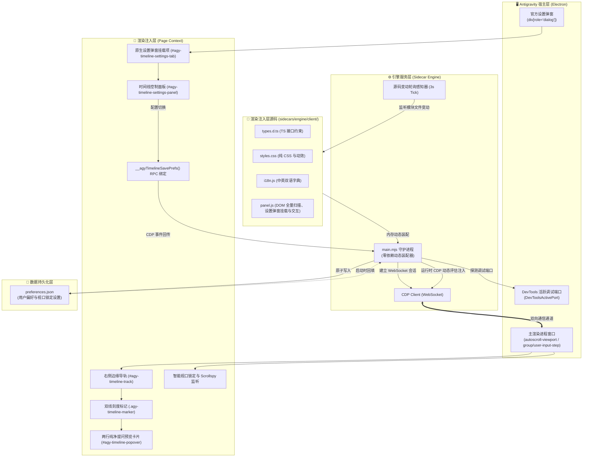
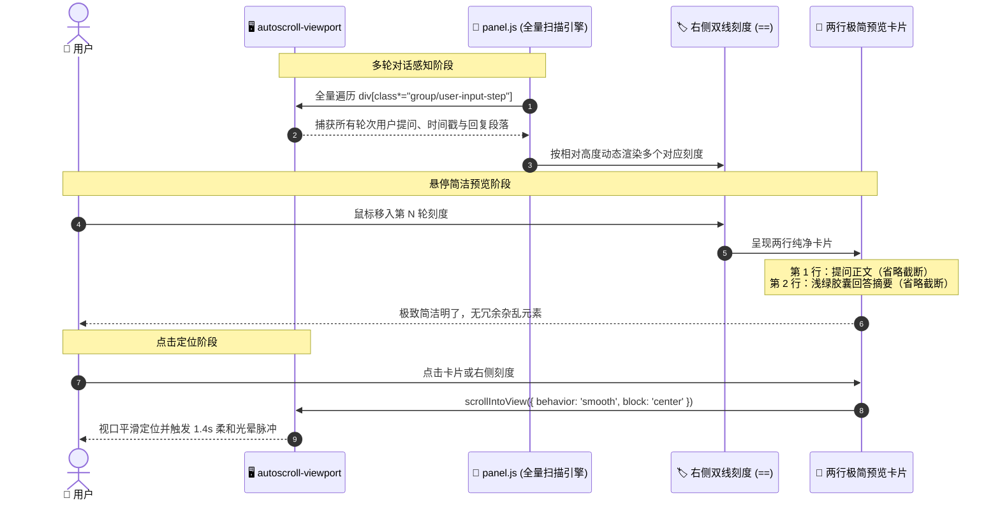

# 系统架构与实现原理 (System Architecture)

本项目为 Antigravity 桌面客户端提供非侵入式的对话时间线导航与智能视口控制能力。无需解包客户端二进制或修改 `app.asar`，利用 Antigravity 原生 Sidecar 运行机制与 Chrome DevTools Protocol (CDP) 调试桥接，实现右侧边缘时间线标记、悬停两行极简预览卡片、原生设置弹窗集成、毫秒级平滑定位、智能视口防滚屏锁定与免重启热重载。

---

## 1. 系统总体架构 (System Architecture)

系统由 **宿主层 (Host)**、**引擎层 (Sidecar Engine)**、**注入层 (Page Renderer)** 与 **数据持久化层 (Storage)** 四部分组成：

---

## 2. 多轮对话扫描与定位时序 (Multi-turn Scan & Navigation)

系统通过全量扫描长对话中的用户提问卡片与对应 AI 回答段落，建立高保真时间轴树：

---

## 3. 原生设置弹窗深度集成 (Native Settings Modal Integration)

对标 `Antigravity-font-settings`，系统监听宿主 `⚙️ Settings`（`div[role="dialog"]`）的生命周期：
1. **菜单挂载**：在设置弹窗左侧导航栏末尾自动插入带图标的「Timeline Settings」按钮；
2. **面板切换**：点击时激活该 Tab，并平滑隐藏原生面板，呈现专属时间线配置表单；
3. **设置项清单**：
   - `禁止发送后自动滑到底部`（开关，智能锁定视口）
   - `在右侧边缘显示时间线刻度`（开关，显示/隐藏右侧刻度）
   - `悬停刻度显示提问预览卡片`（开关，显示/隐藏 Popover）
4. **实时落盘**：配置变更通过 CDP 绑定 `__agyTimelineSavePrefs` 实时写入磁盘 `preferences.json`。

---

## 4. 关键设计原则与隔离规范

1. **非侵入原则**：完全依托 Antigravity 官方 Sidecar 架构与 CDP 调试协议，不修改客户端二进制或 ASAR 归档。
2. **文本截断与紧凑排版**：提问首行超出 48 字符自动截断附加 `...`；回答摘要超出 42 字符单行截断，保证气泡体积轻巧美观。
3. **零外部依赖**：管理脚本 [`manage.py`](manage.py) 完全基于 Python 3 标准库构建，无需 pip 安装任何三方库；卸载时提供纯净 5 步清理，确保系统零残留。
