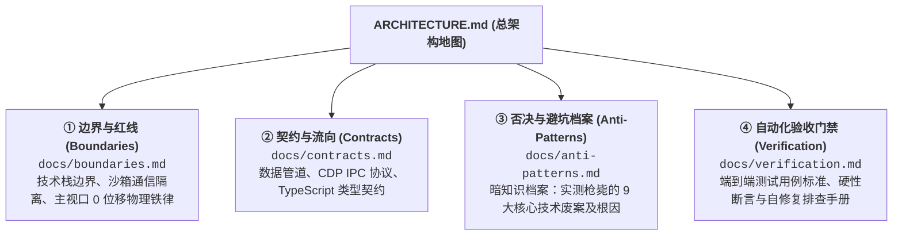

# 系统总架构指南 (System Master Architecture)

本项目为 Antigravity 桌面客户端提供非侵入式的对话时间线导航与智能视口控制能力。
依托 Antigravity 原生 Sidecar 运行机制与 Chrome DevTools Protocol (CDP) 调试通道，实现右侧侧边手柄悬停展开全量对话提问列表、冷数据按需挂载平滑定位、智能视口防滚屏锁定与热重载。

---

## 四维工程真理库 (The 4 Pillars of Architecture)

为了保证系统架构高度内聚、防止复杂度膨胀，系统技术标准划分为四维真理库进行解耦分治，按需检索与渐进式加载：

### 1. [① 边界与红线 (docs/boundaries.md)](docs/boundaries.md)
* **适用场景**：涉及模块重构、权限边界划分、引入新依赖或跨环境调用时必读；
* **核心内容**：主视口 0 像素位移铁律、Chromium 沙箱禁止本地文件跨域读取、后台守护宿主托管原则。

### 2. [② 契约与流向 (docs/contracts.md)](docs/contracts.md)
* **适用场景**：涉及接口变更、数据流向改造、新增通信字段或卡片排版更新时必读；
* **核心内容**：底层 `transcript.jsonl` 单一真实源管道、CDP 双向绑定方法、TypeScript 接口契约。

### 3. [③ 否决与避坑档案 (docs/anti-patterns.md)](docs/anti-patterns.md)
* **适用场景**：排查定位异常、尝试新优化算法或考虑重构方案时必读；
* **核心内容**：详细记录为什么不能依赖前端 DOM、为什么悬停绝不能模拟点击、为什么不能单点监听局部视口容器等 9 大核心被枪毙方案。

### 4. [④ 自动化验收门禁 (docs/verification.md)](docs/verification.md)
* **适用场景**：代码变更提交或发布前必读并全绿通过；
* **核心内容**：指定验证命令 `uv run manage.py test`（或 `python3 manage.py test`）、五大校验阶段硬性断言与自检排查手册。
