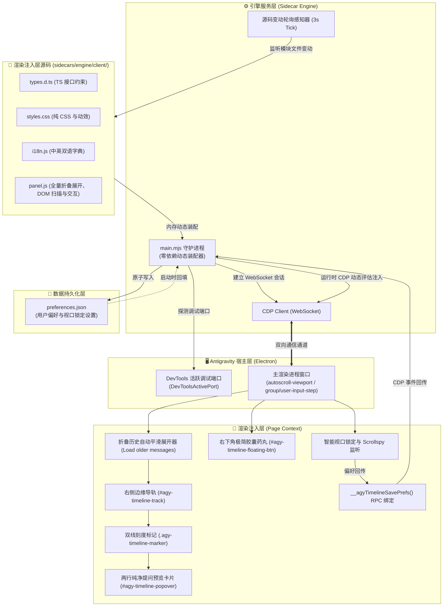

# 系统架构与实现原理 (System Architecture)

本项目为 Antigravity 桌面客户端提供非侵入式、极简纯粹的对话时间线导航与智能视口控制能力。无需解包客户端二进制或修改 `app.asar`，利用 Antigravity 原生 Sidecar 运行机制与 Chrome DevTools Protocol (CDP) 调试桥接，实现全量历史折叠消息自动感知展开、右侧边缘时间线刻度映射、悬停两行极简预览卡片、毫秒级平滑定位、智能视口防滚屏锁定与免重启热重载。

---

## 1. 系统总体架构 (System Architecture)

系统由 **宿主层 (Host)**、**引擎层 (Sidecar Engine)**、**注入层 (Page Renderer)** 与 **数据持久化层 (Storage)** 四部分组成：

---

## 2. 解决 Antigravity 自动折叠历史交互的核心机制

Antigravity 宿主为了前端渲染性能，默认仅在 DOM 中挂载最近的 2~3 轮对话，更早的全部交互均隐藏在顶部的 `Load older messages` 按钮后。本项目通过**静默平滑展开**策略攻克该缺陷：
1. **自动探测**：初始化及动态变动时，实时检测 DOM 顶层是否存在加载更早历史的入口；
2. **平滑展开**：自动模拟触发该操作，同时实时锁死并计算 `scrollTop` 补偿高度差，杜绝画面抖动；
3. **全量映射**：将所有被隐藏的真实轮次（如 7 轮、20 轮、50 轮）全部恢复映射到右侧滚动条时间轴上，计算真实的相对高度百分比；
4. **轻量呈现**：右下角胶囊展示真实统计（例如 `🟢 共 7 轮交互`）。

---

## 3. 极简 UI 设计原则 (Minimalist Pure Design)

- **无多余设置弹窗干扰**：彻底移除宿主设置弹窗内的冗余控制注入，保持界面与宿主一致的极简纯粹。
- **右侧极简双绿线刻度 (==)**：在长文边缘映射交互点，当前视口位置高亮呈现。
- **两行纯净悬停气泡 (Popover)**：
  - **第 1 行**：提问要点正文（单行截断省略号）；
  - **第 2 行**：浅绿背景胶囊条（模型回答摘要单行截断）；
  - 杜绝多层冗余与杂乱重叠。
