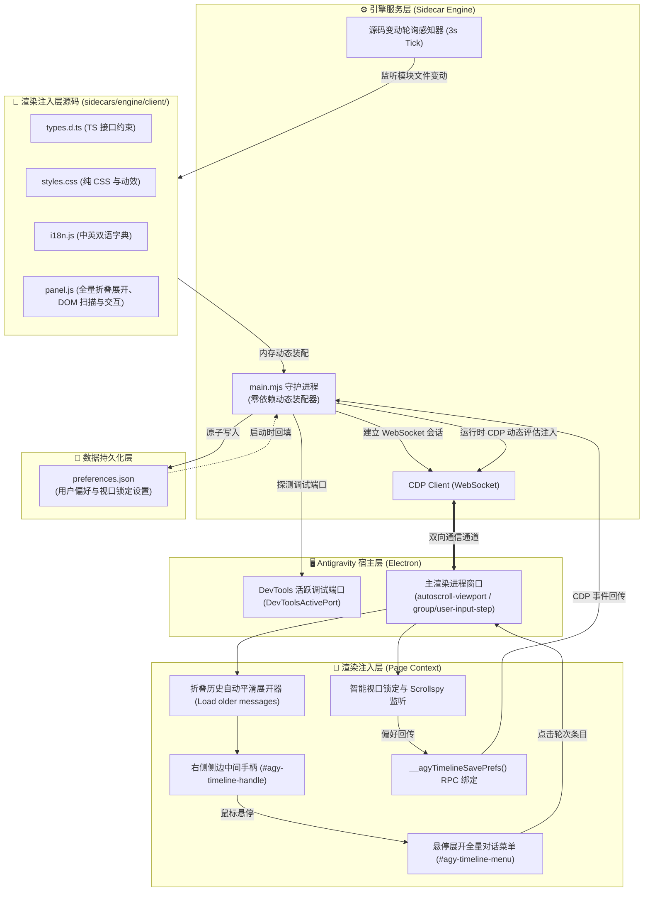

# 系统架构与实现原理 (System Architecture)

本项目为 Antigravity 桌面客户端提供非侵入式、极简纯粹的对话时间线导航与智能视口控制能力。无需解包客户端二进制或修改 `app.asar`，利用 Antigravity 原生 Sidecar 运行机制与 Chrome DevTools Protocol (CDP) 调试桥接，实现右侧中间手柄悬停展开全量对话、条目点击平滑定位、智能视口防滚屏锁定与免重启热重载。

---

## 1. 系统总体架构 (System Architecture)

系统由 **宿主层 (Host)**、**引擎层 (Sidecar Engine)**、**注入层 (Page Renderer)** 与 **数据持久化层 (Storage)** 四部分组成：

---

## 2. 右侧居中手柄与全量对话展开机制

1. **统一锚定至右侧中间区域**：时间线交互入口采用吸附手柄形式固定在视口右侧侧边垂直中间位置（`top: 50%; transform: translateY(-50%)`），避免分散割裂；
2. **悬停触发全量对话列表**：鼠标移入右侧中间手柄，自动向左平滑展开包含全部轮次的导航菜单（`#agy-timeline-menu`），卡片包含单行截断的提问标题与模型回复胶囊；
3. **条目点击毫秒级跳转**：用户在列表中点击任意一轮卡片，主视口通过原生 `scrollIntoView({ behavior: 'smooth', block: 'center' })` 定位至对应位置，并触发目标消息 1.4 秒专属柔和光晕脉冲；
4. **历史折叠消息平滑预载**：启动时检测并平滑展开被宿主折叠的历史交互，保证长对话的所有轮次完整列出。

---

## 3. 关键设计原则与隔离规范

1. **非侵入原则**：完全依托 Antigravity 官方 Sidecar 架构与 CDP 调试协议，不修改客户端二进制或 ASAR 归档。
2. **文本截断与紧凑排版**：提问标题超出 48 字符自动截断附加 `...`；回答摘要超出 42 字符单行截断，保证列表卡片美观规整。
3. **零外部依赖**：管理脚本 [`manage.py`](manage.py) 完全基于 Python 3 标准库构建，无需 pip 安装任何三方库；卸载时提供纯净 5 步清理，确保系统零残留。
