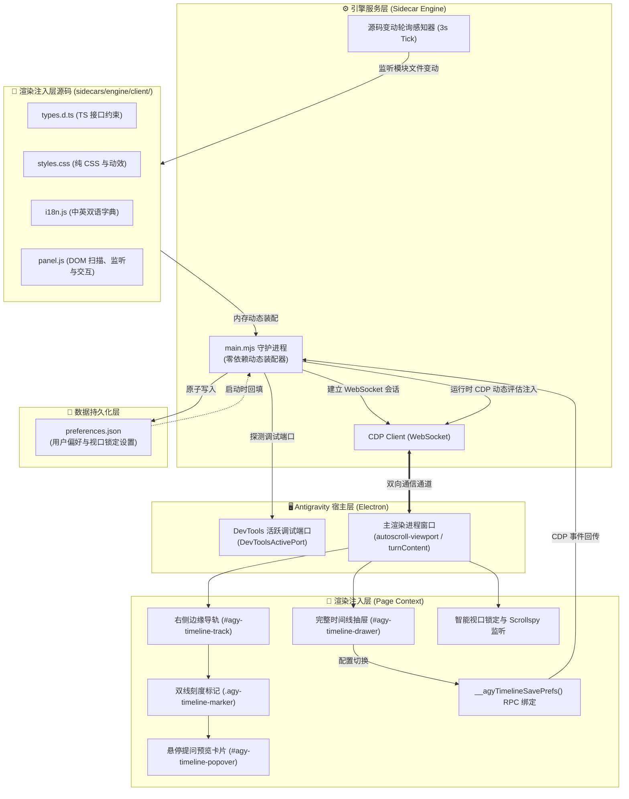
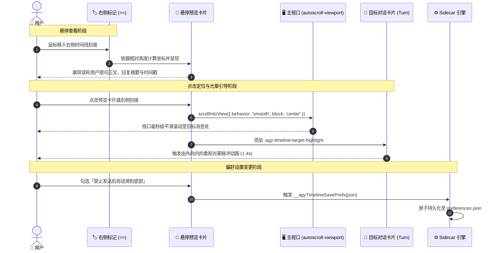
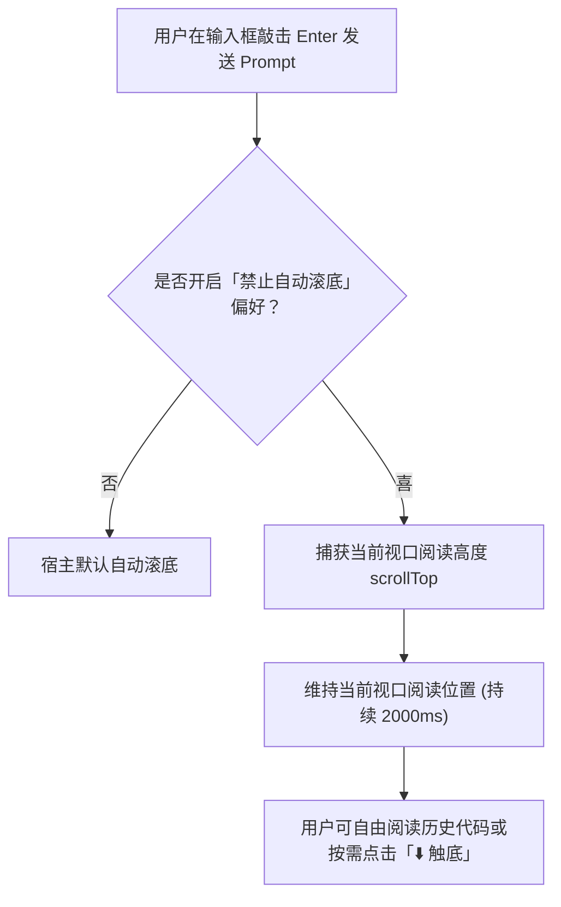
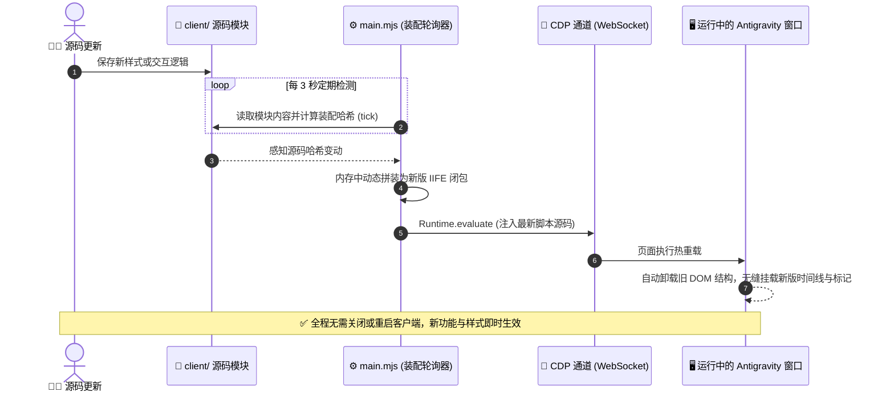

# 系统架构与实现原理 (System Architecture)

本项目为 Antigravity 桌面客户端提供非侵入式的对话时间线导航与智能视口控制能力。无需解包客户端二进制或修改 `app.asar`，利用 Antigravity 原生 Sidecar 运行机制与 Chrome DevTools Protocol (CDP) 调试桥接，实现右侧边缘时间线标记、悬停预览卡片、毫秒级平滑定位、智能视口防滚屏锁定与免重启热重载。

---

## 1. 系统总体架构 (System Architecture)

系统由 **宿主层 (Host)**、**引擎层 (Sidecar Engine)**、**注入层 (Page Renderer)** 与 **数据持久化层 (Storage)** 四部分组成：

---

## 2. 核心交互与定位时序 (Interaction & Navigation Sequence)

用户通过右侧边缘的时间线标记或抽屉节点进行快速定位时，视口平滑滚动与目标视觉反馈的流转时序如下：

---

## 3. 智能视口锁定机制 (Smart Scroll Lock)

Antigravity 宿主在用户发送消息或 Agent 流式响应时，默认会强制执行滚动到底部逻辑。本项目通过对用户交互事件的深度捕获与视口位置检测实现智能锁定：

---

## 4. 免重启热重载机制 (Hot-Reloading Sequence)

当开发者修改了 `client/` 下的样式（`styles.css`）、国际化文案（`i18n.js`）或交互控制器（`panel.js`）时，后台引擎通过 CDP 自动执行热重载，无需关闭或重启 Antigravity 宿主：

---

## 5. 关键设计原则与隔离规范

1. **非侵入原则**：完全依托 Antigravity 官方 Sidecar 架构与 CDP 调试协议，不修改客户端二进制或 ASAR 归档。
2. **样式作用域隔离**：所有注入样式均封装在 `#agy-timeline-*` 命名空间内，利用宿主已有的原生 CSS 变量（`--background`, `--foreground`, `--border`, `--card`, `--primary` 等），实现明暗主题自适应。
3. **零外部依赖**：管理脚本 [`manage.py`](manage.py) 完全基于 Python 3 标准库构建，无需 pip 安装任何三方库；卸载时提供纯净 5 步清理，确保系统零残留。
