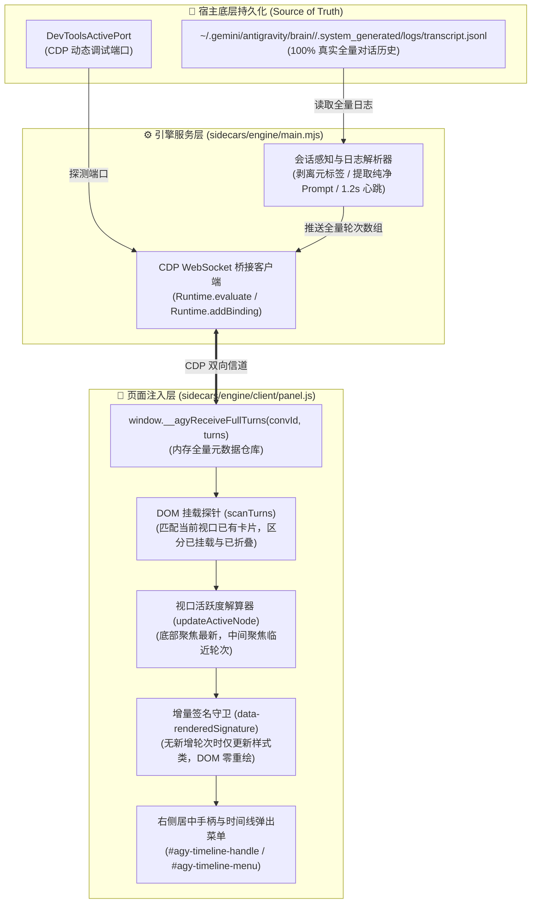

# 系统架构与契约真理 (System Architecture & Truth)

本项目为 Antigravity 桌面客户端提供非侵入式的对话时间线导航与智能视口控制能力。
依托 Antigravity 原生 Sidecar 运行机制与 Chrome DevTools Protocol (CDP) 调试通道，实现右侧侧边手柄悬停展开全量对话提问列表、冷数据按需挂载平滑定位、智能视口防滚屏锁定与热重载。

---

## 一、 边界与红线 (Boundaries)

任何针对本项目的开发或修改，必须严格遵守以下物理红线：

1. **主视口绝对静止红线 (Zero Scroll Displacement)**：
   * 鼠标悬停右侧手柄、划入菜单、滚轮查阅时间线卡片，属于 **100% 纯读动作**；
   * 悬停交互期间，主聊天视口位移严格恒定为 `0 像素`（`viewportScrollDelta === 0`），严禁触发任何导致宿主重新计算滚动高度的模拟点击。
2. **沙箱通信隔离红线 (No Direct Local File Fetch)**：
   * 页面注入层（`client/`）运行在 Chromium 浏览器上下文中，受安全策略限制**绝对无法直接 `fetch("file://...")`**；
   * 所有针对本地日志、配置文件和底层会话数据的访问，必须由后台 Node.js Sidecar 引擎读取，并通过 CDP WebSocket 双向绑定信道安全推送到前端。
3. **冷热数据解耦红线 (Cold Metadata Decoupling)**：
   * 菜单时间线展示全量会话历史时，仅消费内存中的轻量 Prompt 元数据，严禁为了显示菜单而强行将全部早期节点展开挂载进宿主 DOM；
   * 仅当用户在菜单中**显式单击了某一轮折叠会话**时，才允许定向触发宿主展开该轮次并平滑定位。
4. **后台守护托管红线 (Host Daemon Ownership)**：
   * 插件后台引擎由 Antigravity 宿主插件系统在系统底层静默托管（`sidecar.json`）；
   * 交互工具严禁在用户会话级别启动常驻守护任务（Daemon Task），避免在用户操作界面出现干扰性的后台旋转任务框。

---

## 二、 契约与流向 (Contracts & Pipeline)

系统的唯一真实数据源（Single Source of Truth）为宿主本地持久化日志，整体采用**单向数据流管道**架构：



### 核心数据契约类型

```typescript
export interface TimelineTurnNode {
  index: number;              // 轮次编号（从 1 开始递增）
  userText: string;           // 纯净提问摘要（两行截断预览）
  fullText?: string;          // 完整提问正文（用于跨 DOM 前缀精确匹配）
  stepIndex?: number;         // 底层 transcript 内部步骤索引
  responseText: string;       // 留空（纯提问高密度排版，剥离回复）
  timeStr: string;            // 时间戳标记
  element: HTMLElement | null;// 当前是否挂载在宿主 DOM 树上
  topPercent: number;         // 相对滚动高度百分比
  isActive: boolean;          // 是否为当前视口聚焦轮次
  isFolded?: boolean;         // 是否为未载入 DOM 的早期冷数据
}
```

---

## 三、 否决方案与避坑档案 (Anti-Patterns)

以下方案在前期演进中已被**实测否决**，后续维护严禁再次重蹈覆辙：

| 被枪毙的方案 (Dead End) | 触发缺陷与恶果 | 根本原因 | 唯一正确替代方案 |
| :--- | :--- | :--- | :--- |
| **1. 纯前端 DOM 刮取**<br>`querySelectorAll('group/user-input-step')` | 时间线列表严重残缺，长对话往往只展示 2~3 轮。 | 宿主原生实现了虚拟化列表与顶部消息冷折叠，早期历史根本不在前端 DOM 树上。 | **底层直通**：由 Sidecar 直接读取底层 `transcript.jsonl`，获得 100% 完整会话。 |
| **2. 悬停/启动时模拟点击展开**<br>`loadBtn.click()` 递归展开 | 鼠标一放上去，画面瞬间跳回第 2 轮；滚动条剧烈伸缩、正文疯狂闪烁。 | 触发宿主全量排版重排算法，强行篡改了宿主内部的视口滚动锚点。 | **冷热解耦**：全量元数据内存直显；悬停 100% 纯读，绝不触发点击。 |
| **3. 粗粒度固定轮询等待**<br>`while (...) await sleep(260)` | 点击早期折叠卡片时，出现明显迟滞与卡顿（约 1 秒延迟）。 | 固定延时与宿主实际渲染节奏脱节，多次重试累积等待时间。 | **微任务侦听**：使用 `MutationObserver` 侦听宿主 DOM 插入，118ms 瞬时捕获并直达。 |
| **4. 每次渲染粗暴重建 innerHTML** | 鼠标划过卡片时列表闪烁，滚动条位置被反复重置回顶部。 | 销毁已有 DOM 导致浏览器重新布局（Reflow），丢失滚动状态。 | **特征签名守卫**：比对 `dataset.renderedSignature`，无新轮次时仅执行类名微调。 |

---

## 四、 自动化验收门禁 (Verification Gate)

任何代码修改在交付前，必须运行本地端到端测试链路：

```bash
python3 manage.py test
```

### 必须满足的硬性断言 (Hard Assertions)
1. **主视口位移恒为零**：`viewportScrollDelta === 0`，模拟悬停手柄展开菜单，主视口位移严格为 0 像素；
2. **全量会话无遗漏**：`totalTurnsInMenu === transcriptTurns.length`，菜单内卡片数量必须与底层 `transcript.jsonl` 完全一致；
3. **活跃卡片正确对齐**：主视口位于底部时，菜单默认聚焦激活最底部最新轮次；
4. **定向定位与光晕脉冲**：点击条目能够执行平滑直达定位，并激活目标卡片 1.4 秒专属脉冲光晕（`agy-timeline-target-highlight`）；
5. **残留元素零容忍**：界面严禁出现残留的旧浮动按钮或无主手柄。
