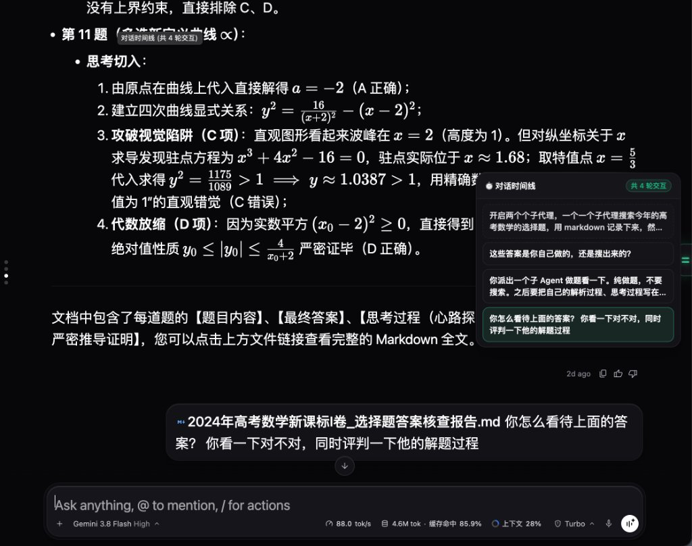

# Antigravity Timeline Navigator

<p align="center">
  
</p>

<p align="center">
  <b>面向 Google Antigravity 桌面端的极简对话时间线导航与视口控制插件</b>
</p>

<p align="center">
  <a href="plugin.json"></a>
  <a href="LICENSE"></a>
  
  
</p>

---

## 📸 效果展示 (Showcase)

<p align="center">
  
</p>

---

## 🚀 快速开始 (Quick Start)

支持 **macOS**、**Linux** 与 **Windows**。基于 Python 3 标准库构建，**零外部包依赖**（无需执行 `pip install` 或 `npm install`）。

### 1. 一键在线安装 (Install)

打开终端运行对应系统的单行命令，自动完成源码拉取与注册启用：

* **macOS / Linux (Terminal)**：
  ```bash
  curl -fsSL https://raw.githubusercontent.com/moumouye/antigravity-timeline/main/install.py | python3
  ```

* **Windows (PowerShell)**：
  ```powershell
  irm https://raw.githubusercontent.com/moumouye/antigravity-timeline/main/install.py | python
  ```

安装完成后，**重启 Antigravity 桌面客户端**即可生效。

---

### 2. 一键在线卸载 (Uninstall)

若需纯净卸载，直接运行对应的清理指令（自动停止后台引擎、清除插件软链、配置与运行时数据，零残留）：

* **macOS / Linux (Terminal)**：
  ```bash
  curl -fsSL https://raw.githubusercontent.com/moumouye/antigravity-timeline/main/uninstall.sh | bash
  ```

* **Windows (PowerShell)**：
  ```powershell
  irm https://raw.githubusercontent.com/moumouye/antigravity-timeline/main/uninstall.ps1 | iex
  ```

---

### 3. Git 源码方式（适合开发者）

```bash
# 克隆仓库
git clone https://github.com/moumouye/antigravity-timeline.git
cd antigravity-timeline

# 一键安装
python3 manage.py install

# 或一键卸载
python3 manage.py uninstall
```

---

## 🛠️ 管理命令 (Management CLI)

在项目目录下运行交互控制台：
```bash
python3 manage.py
# 或使用 uv: uv run manage.py
```

亦可通过命令行参数执行具体操作：

| 操作 | 命令 (标准 Python) | 说明 |
| :--- | :--- | :--- |
| **查看状态** | `python3 manage.py status` | 查看插件安装软链与后台进程状态 |
| **一键安装** | `python3 manage.py install` | 建立软链并在宿主配置中注册启用 |
| **临时禁用** | `python3 manage.py disable` | 暂时停用插件并释放后台引擎 |
| **重新启用** | `python3 manage.py enable` | 重新激活插件 |
| **彻底卸载** | `python3 manage.py uninstall` | 纯净卸载：清除软链、配置条目及运行时数据（零残留） |

---

## 📄 开源许可证 (License)

本项目采用 [MIT License](LICENSE) 授权。
