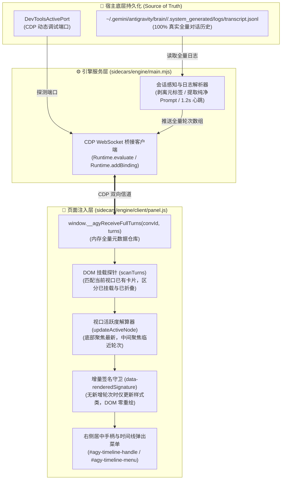

# ② 契约与流向 (Contracts & Data Pipelines)

本文档定义 Antigravity Timeline 插件的数据流向管道、进程间通信（IPC）协议与核心类型契约。

---

## 1. 全局数据流向管道 (Data Flow Architecture)

系统的唯一真实数据源（Single Source of Truth）为宿主本地持久化日志，整体采用**单向数据流管道**架构：



---

## 2. 进程间通信协议 (CDP IPC Bindings)

| 绑定方法 / 评估表达式 | 发起方 | 接收方 | 载荷参数 | 契约职责与说明 |
| :--- | :--- | :--- | :--- | :--- |
| `window.__agyReceiveFullTurns(convId, turns)` | Sidecar | Client | `convId: string`<br>`turns: Array<TranscriptTurn>` | 将解析后的全量会话轮次推入客户端内存，供时间线菜单直出展示。 |
| `__agyTimelineRequestTurns(convId)` | Client | Sidecar | `convId: string` | 客户端路由切换或初始化时，向后台主动请求当前会话的最新数据。 |
| `__agyTimelineSavePrefs(jsonString)` | Client | Sidecar | `jsonString: string` | 客户端修改用户偏好设置后，回传给 Sidecar 执行原子磁盘持久化。 |
| `window.location.pathname` | Sidecar | Client | 无 (查询) | Sidecar 每 1.2 秒轮询客户端当前路径，捕获 `/c/<conv-id>` 会话切换事件。 |

---

## 3. 核心 TypeScript 接口契约 (Type Contracts)

```typescript
/**
 * 时间线单轮会话节点契约
 */
export interface TimelineTurnNode {
  index: number;              // 轮次编号（从 1 开始递增）
  userText: string;           // 纯净提问摘要（两行截断预览，最多 120 字符）
  fullText?: string;          // 完整提问正文（用于跨 DOM 前缀精确匹配）
  stepIndex?: number;         // 底层 transcript 内部步骤索引
  responseText: string;       // 留空（纯提问高密度排版，彻底剥离回复）
  timeStr: string;            // 时间戳标记（HH:mm）
  element: HTMLElement | null;// 当前是否挂载在宿主 DOM 树上（null 表示被宿主冷折叠）
  topPercent: number;         // 相对主视口滚动高度百分比
  isActive: boolean;          // 是否为当前视口正在阅读的活跃轮次
  isFolded?: boolean;         // 是否为未载入 DOM 的早期冷数据
}

/**
 * 用户配置偏好契约
 */
export interface TimelinePreferences {
  disableAutoScrollOnSend: boolean; // 禁止发送提问或模型输出时强制滚底
  showRightEdgeMarkers: boolean;    // 显示右侧边缘双线手柄
  showHoverPreview: boolean;        // 悬停展开完整提问菜单
  markerColor: string;              // 手柄强调高亮色
  language: 'zh' | 'en' | 'auto';   // 多语言配置
}
```
