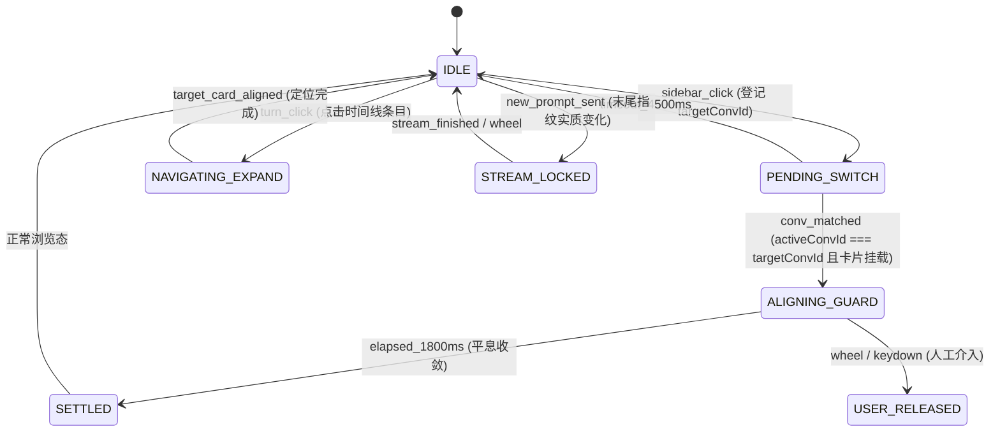

# 智能视口对齐与到达平息规范契约 (Viewport Anchoring & Arrival Guard RFC)

本文档确立客户端视口智能锚定、跨会话到达平息守护、流式输出防滚底与折叠历史按需展开的代数模型与状态机规范。

---

## 1. 业务目标与不变法则 (Context & Invariants)

* **领域核心目标**：在宿主长列表虚拟化与异步自动滚底（autoscroll）机制下，提供跨会话切换直达末轮提问头部、平滑查阅与人工干预毫秒级释放的确定性控制。
* **物理与业务不变量 (Invariants)**：
  1. **悬停纯读 0 位移铁律**：鼠标悬停手柄与菜单展示期间，主视口位移严格恒为 $0\text{px}$（`viewportScrollDelta === 0`），严禁触发任何引起宿主排版重算的 DOM 点击；
  2. **到达守护有界收敛**：跨会话切换的到达纠偏守护必须在首次对齐后的 $1800\text{ms}$ 窗口内平息退出，整体守护硬超时上限为 $4500\text{ms}$，严禁永久常驻争用主线程；
  3. **人工交互即刻让权**：一旦捕获真实用户的滚轮（`wheel`）、按键（`Arrow/Page/Space`）或手势输入，视口控制权必须在 1 帧（$\le 16\text{ms}$）内全量释放；
  4. **指纹比对防误判**：仅在末尾卡片提问文本指纹发生实质改变时判定为新提问，严禁仅凭 DOM 卡片总数增加触发滚屏。

---

## 2. 代数计算模型 (Mathematical Grounding)

### 2.1 元素视口居中目标滚动高度计算
为保证目标提问卡片在视口中拥有舒适的阅读视野，目标滚动位置计算公式定义如下：

$$\text{TargetScrollTop} = \text{Element}.\text{offsetTop} - \max\left(0, \left\lfloor\frac{\text{Viewport}.\text{clientHeight} - \text{Element}.\text{offsetHeight}}{2}\right\rfloor\right)$$

* **偏移容差阈值**：
  $$\Delta_{\text{scroll}} = |\text{Viewport}.\text{scrollTop} - \text{TargetScrollTop}| > 5\text{px}$$
  当且仅当视口偏离大于 $5\text{px}$ 时执行纠正，消除次像素（Sub-pixel）抖动。

### 2.2 到达平息与超时时限公式
* **平息稳态窗口**：
  $$t_{\text{current}} - t_{\text{first\_aligned}} > 1800\text{ms}$$
* **绝对超时熔断上限**：
  $$t_{\text{current}} - t_{\text{session\_arrival\_start}} > 4500\text{ms}$$

---

## 3. 视口控制核心状态机 (State Machine Matrix)

| 当前状态 | 触发事件 | 守卫断言条件 (Guard) | 目标状态 | 副作用动作 (Action) |
| :--- | :--- | :--- | :--- | :--- |
| `IDLE` | `sidebar_click` | 目标卡片有效且包含会话标识 | `PENDING_SWITCH` | 记录 `targetArrivalConvId`，重置对齐时钟，启动守护 RAF 循环 |
| `PENDING_SWITCH` | `raf_tick` / `observer` | `activeConvId === targetArrivalConvId` 且 `userCards.length > 0` | `ALIGNING_GUARD` | 计算末轮卡片目标位置并执行纠正；记录 `firstAlignedTime = now` |
| `PENDING_SWITCH` | `raf_tick` | `now - sessionArrivalStartTime > 4500ms` | `IDLE` | 判定超时，强制退出到达守护 |
| `ALIGNING_GUARD` | `raf_tick` / `scroll` | `now - firstAlignedTime > 1800ms` 且无持续偏离 | `SETTLED` | 退出到达守护，取消 RAF，完全交还宿主控制权 |
| `ALIGNING_GUARD` | `scroll` | `diff > 5px` 且未捕获人工滚动 | `ALIGNING_GUARD` | 抵消宿主异步延迟 autoscroll，重置 `viewport.scrollTop = finalTop` |
| `ANY` | `wheel` / `keydown` | 捕获物理人工滚动事件 | `USER_RELEASED` | 置 `userInteractedWithScroll = true`，立刻取消 RAF 并释放锁定 |
| `IDLE` | `turn_click` | 点击折叠状态冷卡片 | `NAVIGATING_EXPAND` | 标记 `isNavigatingTurn = true`，解除守护锁定，启动按需展开轮询 |
| `NAVIGATING_EXPAND` | `poll_tick` | 目标卡片已在 DOM 挂载 | `IDLE` | 平滑滚动至目标卡片，`finally` 清除 loading 并延时释放导航态 |

---

## 4. 故障恢复与边界降级 (Fault Recovery Matrix)

| 异常破坏场景 | 侦测机制 (Detection) | 强制处置行为 (Action) | 最终一致性保证 (Consistency) |
| :--- | :--- | :--- | :--- |
| **宿主 React 异步滚底反咬** | 切换后 500~1500ms 视口偏离末轮头部 $> 5\text{px}$ | 在 $1800\text{ms}$ 平息窗口内通过 RAF 纠正对齐 | 最终稳定在末轮卡片起始行 |
| **会话切换旧卡片 DOM 延迟卸载** | `activeConvId !== targetArrivalConvId` | 阻断卡片对齐计算，持续等待活跃容器完成切换 | 杜绝基于上一会话旧卡片误算坐标 |
| **历史加载按钮处于 React 禁用态** | `loadBtn.disabled === true` | 以 $60\text{ms}$ 步长自适应轮询，最长等待 $1200\text{ms}$ 解除 | 避免 `while` 循环早退导致展开假死 |
| **DOM 卡片前缀带富文本引用胶囊** | 卡片首部包含 `@Quote` 或 `.context-scope-mention` | 正则预先剥离胶囊，以首两行纯净文本建立双向指纹比对 | 消除折叠卡片与底层日志对应错位 |

---

## 5. 机械化断言与测试防线 (Verification Contract)

* **关联自动化测试套件**：[`sidecars/engine/test_e2e.mjs`](../../sidecars/engine/test_e2e.mjs)
* **硬性物理断言对**：
  1. `arrivalAnchorVerified === true`：验证跨会话切换后视口对齐末轮卡片头部，终态偏离度严格在容限范围内；
  2. `noBottomRebound === true`：验证点击非末轮历史卡片跳转后，视口在观察窗口内绝对不发生回弹至末轮；
  3. `foldedExpansionGuarded === true`：验证早期折叠历史展开定位全链路平稳执行，最终脱离 `.is-loading` 状态。
