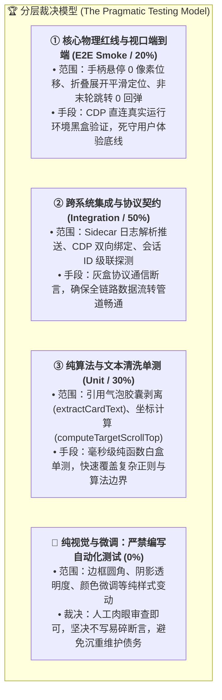
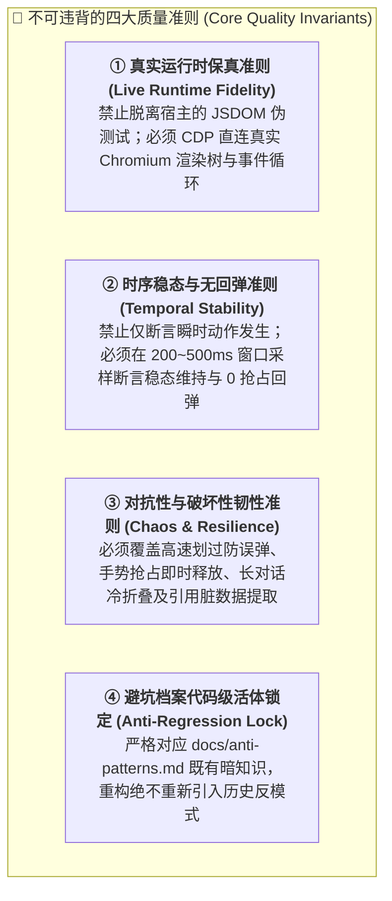
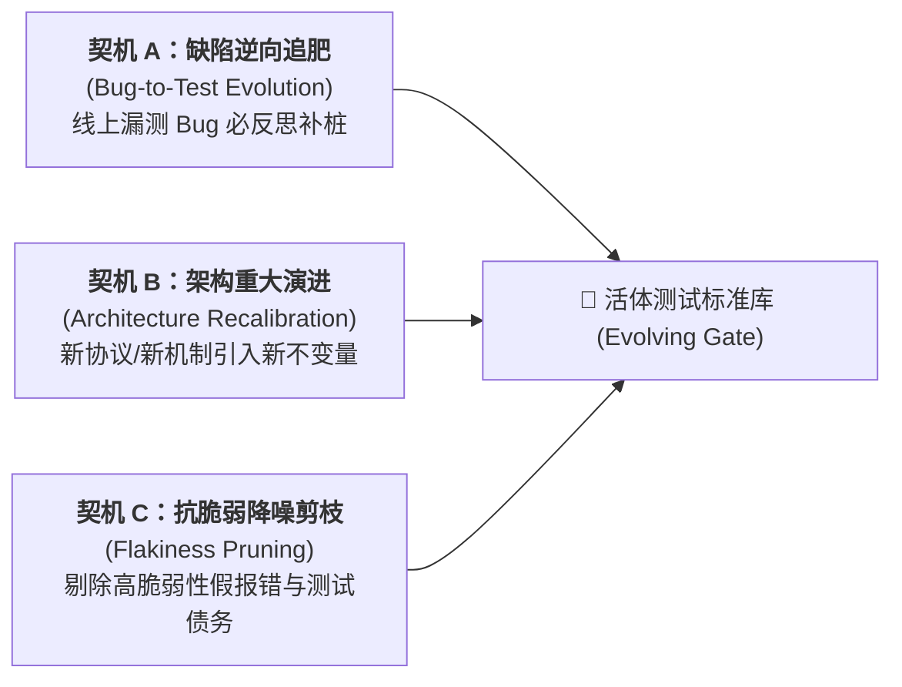

# ④ 质量工程与验收准则 (Quality Standards & Invariant Gate)

本文档确立系统的自动化测试哲学、不可违背的四大物理不变量、分层裁决经济学与测试标准的持续演进机制。
本项目全面践行 **“准则与不变量驱动（Invariant-Driven）”**，彻底摒弃死板教条的操作流水账，赋予测试套件自主进化与深度对抗的灵活性。

所有代码变更提交前，**必须本地运行并通过自动化测试门禁（退出码 0）**。

---

## 1. 测试分层与经济学裁决准则 (Testing Layering & Pragmatic Economics)

软件测试的终极目的，不是在数学上证明“系统绝对没有 Bug”，而是**以最小的维护成本换取最大的重构安全感**。
本项目严禁形式主义的“全量覆盖”，严格按分层裁决模型分配精力：



---

## 2. 唯一指定测试门禁 (Execution Command)

```bash
uv run manage.py test
# 或 python3 manage.py test
```

* **判定标准**：进程退出码必须为 `0`（全绿通过）；
* **门禁阻断**：若出现退出码 `1` 或抛出未捕获异常，**硬性阻断代码提交与版本发布**，须在本地定位并完成根因修复。

---

## 3. 四大核心质量准则与不可违背的物理不变量 (The 4 Quality Invariants)

测试脚本的具体代码实现与用例编排不设刻板限制，但测试套件必须严格满足以下四大刚性物理不变量：



### 准则 1：真实运行时保真准则 (Live Runtime Fidelity)
* **核心思想**：拒绝脱离真实环境的无意义内存 Mock（如单纯在 Node.js 中 mock DOM 节点）；
* **刚性标尺**：
  - 测试套件必须通过动态调试端口（`DevToolsActivePort`）依托 CDP 直连运行中的 Electron 桌面实例；
  - 必须在真实的 Chromium 渲染树重排（Reflow）、React 虚拟长列表卸载、真实 CSS 样式级联与浏览器微任务队列中接受检验。

### 准则 2：时序稳态与无回弹准则 (Temporal Stability & Anti-Rebound)
* **核心思想**：拒绝单一的“快乐路径（Happy Path）”瞬时断言；动作“发生了”不等于“保持住了”；
* **刚性标尺**：
  - **物理位移绝对静止红线**：手柄悬停、菜单展开与纯查阅期间，主视口位移严格恒为 `0 像素`（`viewportScrollDelta === 0`），容差为 0；
  - **时延窗口稳态断言**：执行跳转定位后，测试必须在目标到达后的 $200\text{ms} \sim 500\text{ms}$ 时间窗口内持续采样视口坐标，证明视口**绝对未被后台的 autoscroll 钩子、微任务纠偏或旧状态看门狗拽回底部**；
  - **到达守护有时限收敛**：会话进入/切换后的到达锚定逻辑必须在 $1800\text{ms}$ 内平息退出，严禁永久常驻消耗主线程。

### 准则 3：对抗性与破坏性韧性准则 (Chaos & Disruption Resilience)
* **核心思想**：测试必须充当挑剔的对抗者，覆盖真实用户操作中的非平坦场景；
* **刚性标尺**：
  - **高速划过意图对抗**：模拟鼠标光标以低于 $100\text{ms}$ 的瞬态速度划过手柄热区，断言 Hover Intent 防抖必须有效拦截菜单误弹；
  - **用户控制权抢占对抗**：平滑滚动动画执行中途，一旦注入真实用户滚轮（`wheel`）或按键交互，插件必须在 1 帧（$16\text{ms}$）内立刻释放视口控制权；
  - **极限尺度与冷折叠对抗**：对 1 轮新会话、多轮平坦会话、20 轮以上多级冷折叠会话均能自适应处理；
  - **脏数据与富文本解析对抗**：提问首部包含引用气泡胶囊（`@[Quote]`）、文件 Mention、超长连续字符或多换行时，文本提取函数必须 100% 纯净解耦，不得出现折叠状态误判与死锁展开。

### 准则 4：避坑档案代码级活体锁定 (Anti-Regression Living Lock)
* **核心思想**：项目在演进中踩过的每一个坑，都必须沉淀为不可倒退的机器防护网；
* **刚性标尺**：
  - 严格对照 [`docs/anti-patterns.md`](anti-patterns.md) 记录的避坑档案（AP-01 至 AP-10），测试必须内含对应的防御性断言；
  - 严禁将展开历史消息误判为新提问、严禁将瞬态 query 作为会话主键、严禁破坏整屏热区。

---

## 4. 验收断言参考清单 (Assertion Reference)

当前官方端到端测试脚本 [`sidecars/engine/test_e2e.mjs`](../sidecars/engine/test_e2e.mjs) 围绕上述不变量实施的六大核心断言：

| 校验环节 | 验证对象 | 硬性断言指标 (Hard Assertions) | 判定通过标准 |
| :--- | :--- | :--- | :--- |
| **[1/6] 源码装配** | 客户端注入资产 | IIFE 自执行脚本语法解析无异常 | 成功装配且代码长度符合基线 |
| **[2/6] 端口与会话** | CDP 调试通道 | 读取动态端口并建立 WebSocket 通信 | 成功接入 Electron 目标窗口 |
| **[3/6] 热注入评估** | 渲染进程上下文 | `Runtime.evaluate` 注入自执行代码 | 运行时 `exceptionDetails` 严格为空 |
| **[4/6] 悬停静止与对齐** | 手柄交互与菜单展示 | 1. `viewportScrollDelta === 0`<br>2. `totalTurnsInMenu === transcriptTurns.length`<br>3. `hasResidualFloatBtn === false`<br>4. `hasActiveCard === true` | **主视口位移严格为 0 像素**，菜单条目与底层日志完全相等，无旧按钮残留 |
| **[5/6] 自然平滑定向跳转** | 显式点击定位 | 1. `cardClicked === true`<br>2. `noHighlightPollution === true` | 触发平滑定位，无任何多余绿色光晕样式污染，零贴合精准对齐 |
| **[6/6] 防回弹与防误判门禁** | 稳态轨迹与脏数据解析 | 1. `cleanTextExtracted === true`<br>2. `noBottomRebound === true`<br>3. `regressionProtected === true` | 引用胶囊纯净剥离，非末轮跳转杜绝被强推回末轮 |

---

## 5. 测试标准的生命周期与持续重估机制 (Living Standards & Continuous Re-evaluation)

测试标准绝非刻在石头上的死板教条，它随系统演进而动态进化。系统在以下三个关键契机**无条件触发测试标准的重新评估与重构升级**：



1. **缺陷逆向追肥机制（Bug-to-Test Pipeline）**：
   - 凡是在日常使用或生产中暴露了新 Bug，首要复盘问题永远是：**“为什么现有的测试门禁漏掉了这个场景？”**；
   - 修复缺陷的同时，必须在 [`docs/anti-patterns.md`](anti-patterns.md) 确立新反模式，并向测试套件中追加反向断言，将该 Bug 终身锁定；
2. **架构同步重估机制（Architecture-Synchronized Recalibration）**：
   - 当系统引入重大架构升级（如由传统轮询升级为全量 CDP 直通、引入多源级联会话探测时），测试标准必须同步重估；
   - 淘汰与旧架构强绑定的低层实现测试，升级为针对新架构核心承诺的行为断言；
3. **抗脆弱降噪剪枝机制（Flakiness Pruning & Debt Reduction）**：
   - 若某项测试断言经常因宿主无害的样式名微调而产生假阳性（False Alarm），则证明该断言陷入了“死板流程”，属于脆弱测试；
   - 必须立即对该断言进行重估剪枝，将其升维为不依赖具体类名的“物理几何与行为不变量断言”，确保测试运行极速、精准、高信噪比。

---

## 6. 常见物理不变量破坏排查指南 (Troubleshooting)

若测试运行报错，参照下表排查物理不变量破坏原因：

1. **破坏：`悬停导致主视口产生非预期位移 (Xpx)`（违反准则 2）**：
   * **排查**：检查 `panel.js` 中的 `showMenu()` 或 `scanTurns()` 是否又调用了 `loadBtn.click()`。
   * **修复**：悬停必须是 100% 纯读，绝不触发 DOM 点击。
2. **破坏：`检测到非末轮跳转被强推回末轮的异常回弹`（违反准则 2、4）**：
   * **排查**：检查点击跳转时是否未登记 `isNavigatingTurn = true`，或 `checkAndApplyViewAnchoring` 是否又仅凭 `userCards.length` 判定新提问。
   * **修复**：坚持以末尾卡片提问指纹比对，并在主动导航期间全面解绑滚底看门狗。
3. **破坏：`引用胶囊纯净提问文本剥离失败`（违反准则 3）**：
   * **排查**：检查 `extractCardText` 是否遗漏了新的宿主富文本类名（如 `.context-scope-mention` 或 `[class*="inline-pill"]`）。
   * **修复**：更新胶囊节点过滤选择器。
4. **破坏：`未检测到 Antigravity 调试端口文件 (DevToolsActivePort)`（违反准则 1）**：
   * **排查**：Antigravity 桌面客户端未启动。
   * **修复**：启动 Antigravity 桌面客户端后重跑测试。
